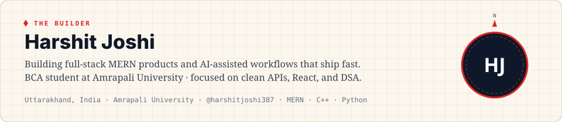
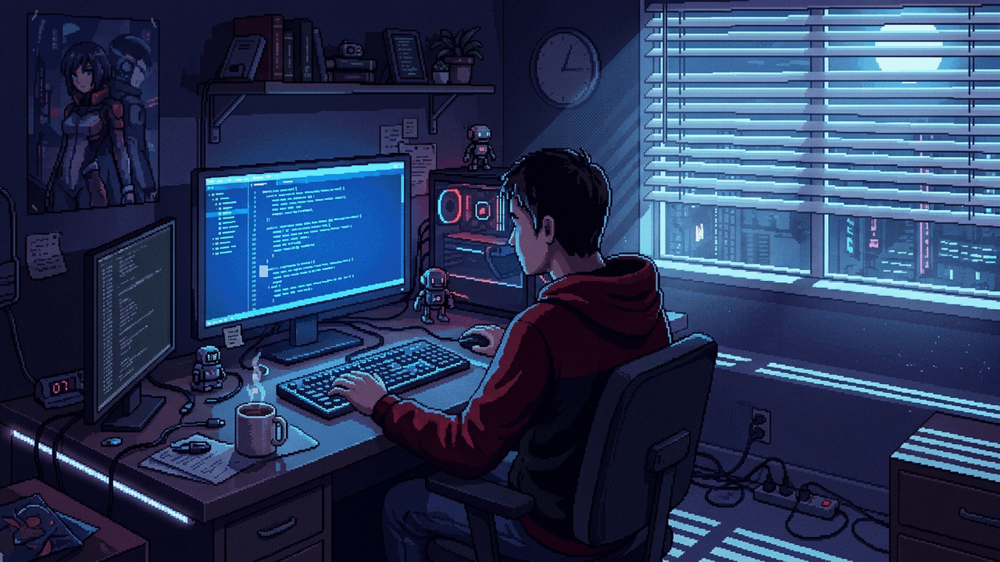
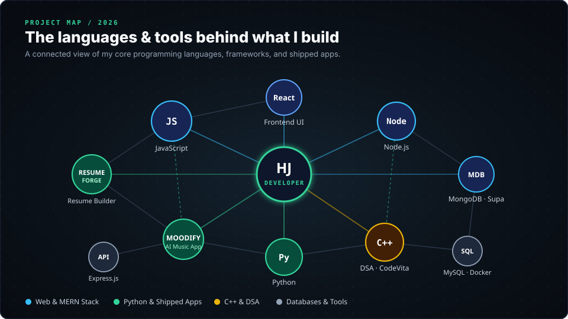
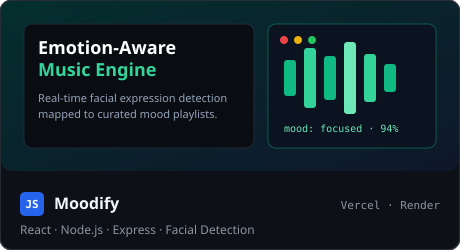
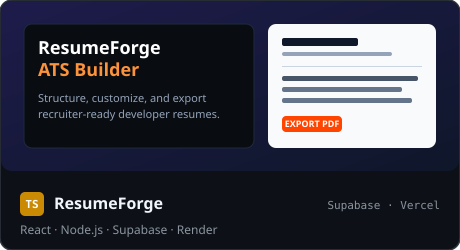

# 

<!-- Introduction Card -->

  

<!-- Animated Coding Banner -->

  

 

<!-- Developer Project Map -->

  

    

  

    <a href="https://github.com/harshitjoshi387">GitHub</a> ·
    <a href="https://www.linkedin.com/in/harshit-joshi-79600823b/">LinkedIn</a> ·
    <a href="mailto:harshit.dev409@gmail.com">Email</a>
  

 

## Up close

  <table>
    <tr>
      <td width="50%" valign="top">
        
      </td>
      <td width="50%" valign="top">
        
      </td>
    </tr>
  </table>

 

## 🛠️ Tech Stack

  

 

## 📊 GitHub Stats & Activity

  

  

    

  

  

 

---

  ### Thanks for visiting! ✨

  *Building ideas into digital experiences.*

  

